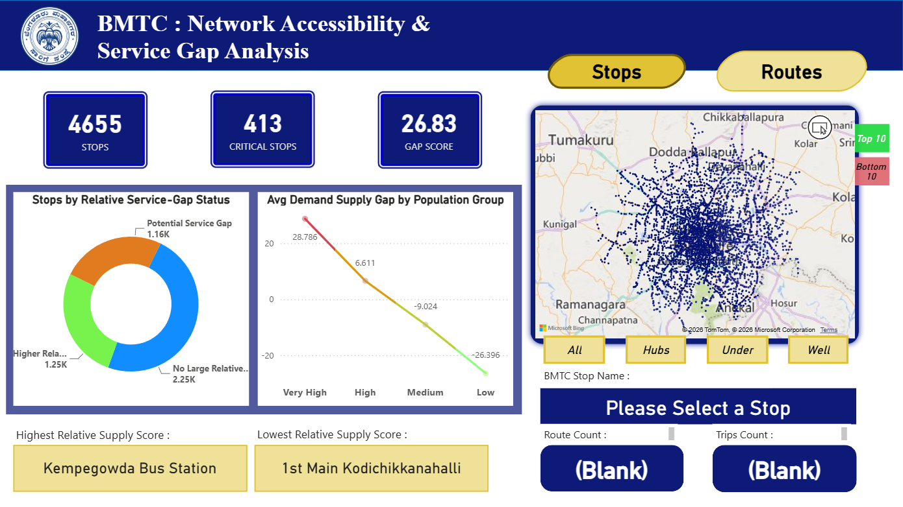
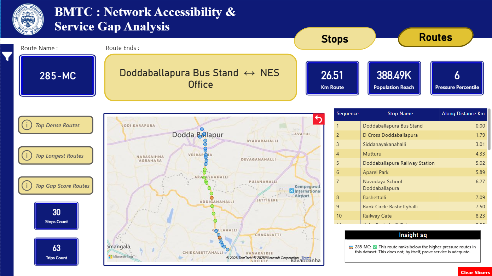
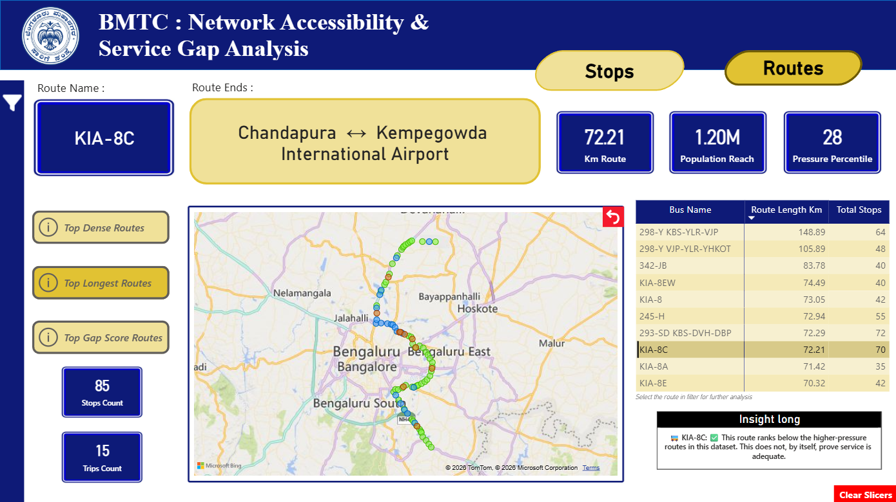

# 🚌 BMTC Transit Network Accessibility & Service Gap Analysis

An exploratory geospatial analytics and Power BI project that examines how recorded BMTC route/stop service indicators compare with the population living around bus stops in Bengaluru. The project combines stop locations, route geometries, and the GHSL population grid to highlight locations and routes that may deserve closer investigation.

> **Scope:** This is a screening and exploration tool, not an official BMTC service audit. Population near a stop is not the same as passenger demand, and a spatially inferred stop-route match is not proof that a bus serves that stop.

---

## Dashboard preview

### Stops dashboard

*Explore the stop network, relative demand-supply gaps, population-catchment groups, and high-priority candidate stops.*

### Routes dashboard

*Inspect a selected route's geometry length, estimated population catchment, relative pressure percentile, and inferred stop sequence.*

### Route rankings

*Compare routes by recorded trip count, geometry length, and the average gap score of inferred representative stops.*

---

## 1. The question behind the project

Bengaluru's bus network is spatially complex. A list of routes and stops is useful, but it does not by itself answer questions such as:

- Which stops sit in areas with a relatively high surrounding population but comparatively low recorded service indicators?
- Do stops in higher population-catchment groups tend to show larger demand-supply gaps?
- Which routes have large population catchments relative to their recorded trip counts?
- Can route geometry and stop coordinates be combined into an approximate, ordered route-stop view when a dependable operational stop sequence is unavailable?

The project turns these questions into an interactive analytical workflow. The dashboard lets a user explore the network and compare candidate locations; the findings below summarize patterns found in the current dataset snapshot.

## 2. Data discovery and source challenges

Finding suitable input data was a meaningful part of the project. I explored public and government-facing data catalogues, including the [Open Government Data Bengaluru transportation catalogue](https://tn.data.gov.in/catalog/transportation-bengaluru), while looking for a consistent, machine-readable source that could support route geometry, stop coordinates, and reliable stop-by-stop sequences together.

For the route and stop geometry used in this project, the practical working source was an **unofficial GTFS-derived dataset based on information displayed in the Namma BMTC app**. See the [upstream BMTC GTFS repository](https://github.com/ponraghuram/bmtc-gtfs). Its maintainers caution that the app data can be inaccurate—particularly timetable and stop timings—and that only routes with functional live tracking are represented. Therefore, the dataset is useful for exploring broad network patterns, but it should not be treated as a complete, authoritative inventory of BMTC operations.

The main challenge was not simply importing the data. The source route count did not consistently agree with the number of nearby stop candidates, and a reliable operational stop sequence could not be established for every route. Instead of pretending these mismatches were resolved ground truth, the project retained diagnostic fields, inferred candidate matches spatially, grouped very close candidates, and documented the limitations.

### Population data

The project uses the [Global Human Settlement Layer (GHSL) GHS-POP population grid](https://human-settlement.emergency.copernicus.eu/ghs_pop2023.php), produced by the European Commission's Joint Research Centre. The workflow uses a population raster for epoch 2020 and estimates the population represented within a 1 km radius around each stop.

This provides a consistent spatial proxy for nearby resident population. It does **not** measure bus boardings, passenger counts, trip purpose, walking access, or the number of unique people using BMTC.

---

## 3. Results at a glance

These figures were generated from the final dataset workbooks used for the current dashboard revision. Rankings and counts can change if the inputs or scoring rules change.

| Measure | Current result | Interpretation |
|---|---:|---|
| Aggregated stops | **4,655** | Stop-level analysis records |
| Source route records after scope filtering | **3,398** | Routes retained from 3,901 cleaned route records |
| Routes excluded by the low-source-stop-count filter | **503** | Records with source `stop_count < 5`; excluded as a scope decision, not declared invalid |
| Inferred route-stop clusters | **114,608** | One route-specific cluster per mapping row |
| Raw stop candidates matched to route lines | **137,265** | Candidate route-stop relationships before clustering |
| Candidate matches absorbed by clustering | **22,657** | Reduction from clustering nearby candidates |
| Critical-gap stops | **413 (8.9%)** | Stops with `gap_score > 50` under the project's screening rule |
| Positive-gap stops | **1,159 (24.9%)** | Stops with `gap_score > 20`, classified as Potential Service Gap |
| High-gap + low-service-volume candidates | **186 (4.0%)** | Stops with `gap_score > 50` and `service_volume_score < 10` |
| Average absolute gap magnitude | **26.83** | Typical size of the signed demand-supply difference, ignoring direction |
| Median route geometry length | **19.63 km** | Length calculated from the supplied route line geometry |

The mean **signed** gap score is approximately zero because positive and negative gaps cancel when averaged. The average absolute gap magnitude of **26.83** is more useful for describing the typical size of the difference. Neither is a percentage of unmet demand.

---

## 4. Data preparation and geospatial workflow

The analytical data preparation was completed in Python before the Power BI model was refreshed.

### 4.1 Prepare the stops

The working stop input was already an aggregated stop dataset: upstream processing combined duplicate or side-specific source records where appropriate. The cleaning step validated stop coordinates and count fields, derived latitude and longitude from point geometry, and assigned a stable row-based `stop_id`. Existing same-name records at different coordinates were not blindly merged again.

### 4.2 Connect population to stops

1. Reproject spatial operations to **EPSG:32643 (UTM zone 43N)** so distance calculations use metres.
2. Create a **1,000 m radius catchment** around each stop.
3. Overlay each catchment on the GHSL population raster and sum valid positive population-cell values included in the catchment.
4. Retain stop-to-raster-cell membership for the route-level population union performed later.

Stop catchments overlap. Consequently, summing `ghsl_population_1km` across stops would double-count people in overlapping catchments and must not be interpreted as unique Bengaluru population.

### 4.3 Calculate relative stop scores

Population, route count, and recorded trip count are converted into percentile scores on a 0–100 scale. The route-diversity and service-volume percentiles are averaged to create a supply proxy; the demand percentile minus the supply proxy becomes the gap score. The thresholds are project-defined screening choices, not official BMTC standards.

### 4.4 Infer route-stop relationships

The route input contains route-line geometries. The mapping workflow:

1. Retains route records with a source `stop_count` of at least five. This excludes 503 of 3,901 cleaned route records; it is a pragmatic scope filter, not proof that every excluded record was invalid or non-public.
2. Reprojects routes and stop points to EPSG:32643 and creates a **50 m buffer** around each route line.
3. Treats stops within that buffer as candidate matches and deduplicates each route-stop ID pair.
4. Projects each candidate point onto the route geometry and sorts candidates by the estimated along-line distance.
5. Clusters nearby candidates using an anchor rule: a candidate must be within **100 m along the route** and within **100 m in straight-line distance** of the current cluster anchor.
6. Selects one representative for the displayed mapping row while retaining member IDs and names for traceability. Population catchments later use **all candidate IDs in each cluster**, not just the representative.

This reduces obvious near-duplicate variants and creates an approximate sequence for visual analysis. It cannot reliably distinguish all stops on parallel roads, opposite directions, nearby route segments, or loops/crossings in route geometry.

### 4.5 Build route-level population metrics

For each retained route, the workflow unions raster-cell IDs contributed by the catchments of all candidate stops represented in that route's clusters. A cell is counted once per route even if multiple stop catchments on that route include it. Routes can still share raster cells, so route-catchment populations must not be summed across routes as unique network population.

---

## 5. Final dashboard datasets

The Power BI model uses three related tables. The current workbook versions are listed below; their logical fields correspond to the pipeline's final table exports.

| Workbook / table | Grain | Rows × fields | Role |
|---|---|---:|---|
| `stops_for_powerbi.xlsx` / `stops_for_powerbi` | One aggregated stop per row | **4,655 × 21** | Stop locations, population proxy, service indicators, relative scores, and classifications |
| `routes_for_powerbi_with_population.xlsx` / `routes_for_powerbi` | One retained route record per row | **3,398 × 21** | Route label and endpoints, geometry length, inferred stop counts, population catchment, and pressure ranking |
| `route_stop_mapping.xlsx` / `route_stop_mapping` | One inferred cluster on one route per row | **114,608 × 13** | Relationship bridge between routes and representative stops; approximate sequence and cluster audit fields |

### Relationship model

- `routes_for_powerbi[route_id]` → `route_stop_mapping[route_id]` is one-to-many.
- `stops_for_powerbi[stop_id]` → `route_stop_mapping[stop_id]` is conceptually one-to-many. The `stop_id` on the mapping row is the representative stop for that cluster.
- A physical or canonical stop can appear on multiple routes. A cluster can contain several original candidate IDs; `cluster_stop_ids` is pipe-separated audit metadata, not a relational key.
- Route IDs should remain **text** because IDs may be alphanumeric. Stop IDs should remain a consistent whole-number type across the stop and mapping tables.

A separate route-line geometry source may be needed by the Power BI map. The enriched route workbook contains calculated route metrics but does not replace the original route WKT geometry source if the visual depends on that geometry.

---

## 6. Custom metrics: what they mean

These formulas are deliberately transparent, project-defined proxies. They are not standard transport-planning formulas or official BMTC performance measures.

### Stop-level calculations

**Percentile score**

`percentile_score(x) = rank(x, method="average", pct=True) × 100`

Values are ranked within the current dataset and scaled to 0–100. Ties receive the average rank. These scores show *relative position among the stops*, not absolute demand or supply.

| Field | Formula / rule | Intended interpretation |
|---|---|---|
| `demand_score` | Percentile rank of `ghsl_population_1km` × 100 | How high a stop's local population-catchment estimate ranks relative to other stops |
| `route_diversity_score` | Percentile rank of `route_count` × 100 | Relative position by recorded number of routes associated with the stop |
| `service_volume_score` | Percentile rank of source `trip_count` × 100 | Relative position by the source trip-count value |
| `supply_score` | `(route_diversity_score + service_volume_score) / 2` | Equal-weight relative supply proxy balancing route breadth and recorded service volume |
| `gap_score` | `demand_score - supply_score` | Positive: demand proxy ranks above supply proxy; negative: supply proxy ranks above demand proxy |
| `critical_gap_flag` | `gap_score > 50` | Critical-gap screening flag |
| `priority_tier` | Critical if gap > 50; Potential if gap > 20; otherwise Not Flagged | Priority categories based on the chosen score thresholds |
| `status` | Potential Service Gap if gap > 20; Higher Relative Supply if gap < -20; otherwise No Large Relative Gap | Three-way summary of the relative gap |
| `population_catchment_group` | Demand score ≤25: Low; ≤50: Medium; ≤75: High; >75: Very High | Four groups based on relative demand-score bands, not absolute population-density classes |
| `accessibility_level` | Route-count bands: ≥15 Excellent; ≥10 Good; ≥5 Fair; otherwise Poor | Legacy route-count label; not a measure of walkability, wait time, or verified service quality |
| `service_frequency` | Trip-count bands: ≥200 Very High; ≥100 High; ≥50 Medium; otherwise Low | Categorical label derived from source trip count—not timetable headway or verified frequency |
| `connectivity_score` | `(route_count × 10) + (trip_count / 10)` | Legacy weighted index retained for compatibility; not used as the revised `supply_score` |

### Route-level calculations

| Field | Formula / rule | Intended interpretation |
|---|---|---|
| `route_total_length_km` | Projected route geometry length / 1,000 | Polyline length in km, not verified journey distance or road-network shortest path |
| `raw_candidate_match_count` | Distinct stop IDs within the 50 m route buffer, before clustering | Number of spatial candidates associated with the route |
| `inferred_mapped_stop_count` | Number of route-specific clusters after clustering | Approximate stop sequence length, not an authoritative stop count |
| `merged_candidate_count` | `max(raw_candidate_match_count - inferred_mapped_stop_count, 0)` | Candidates absorbed into clusters; not proof that every candidate was a duplicate |
| `mapped_stop_count_delta` | `inferred_mapped_stop_count - stop_count` | Difference from the source count, used as a diagnostic |
| `route_population_catchment` | Sum of unique population raster-cell values across all candidate stop catchments within a route | Route-specific population proxy; different routes' catchments can overlap |
| `population_to_service_ratio` | `route_population_catchment / trip_count`, when trip count is positive | Estimated population catchment per recorded source trip-count unit; not passengers per bus or crowding |
| `pressure_percentile` | Percentile rank of `population_to_service_ratio` × 100 | Relative rank of the proxy among retained routes; not an official pressure/strain index |

### Mapping sequence and cluster fields

The mapping stores `stop_sequence`, `distance_along_route_m`, `distance_to_route_m`, and `quality_flag`, along with `cluster_member_count`, `cluster_stop_ids`, `cluster_stop_names`, `cluster_start_distance_m`, `cluster_end_distance_m`, and `cluster_width_along_route_m`. The representative stop is chosen as the candidate closest to the route line; ties prefer names without a `CS-` / `CS` prefix, then the lowest stop ID. Cluster position is the median along-route distance of its members.

---

## 7. Findings from the current data

### 7.1 Stop-level service-gap profile

| Relative status | Stops | Share |
|---|---:|---:|
| No Large Relative Gap | 2,247 | 48.3% |
| Higher Relative Supply | 1,249 | 26.8% |
| Potential Service Gap | 1,159 | 24.9% |

The wider priority tier contains 413 Critical Gap stops (8.9%), 746 Potential Gap stops (16.0%), and 3,496 stops not flagged by the priority thresholds (75.1%). The `Potential Service Gap` status and `Potential Gap` priority tier are different classifications, so their counts are not expected to match.

A narrower combination—`gap_score > 50` **and** `service_volume_score < 10`—identifies **186 stops (4.0%)** for focused review. This intersection combines a large positive relative gap with a very low relative service-volume rank.

### 7.2 Gap patterns across population-catchment groups

| Relative catchment group | Stops | Mean gap score | Median gap score | Mean absolute gap |
|---|---:|---:|---:|---:|
| Very High | 1,164 | **28.79** | 22.15 | 32.54 |
| High | 1,164 | **6.61** | 4.22 | 23.32 |
| Medium | 1,164 | **-9.02** | -8.04 | 22.50 |
| Low | 1,163 | **-26.40** | -22.76 | 28.95 |

The mean gap becomes more positive as the population-catchment group rises. Under this scoring design, the Very High group has the largest average positive gap and the Low group the largest average negative gap. These are relative score bands, not census density categories, and the pattern is not direct evidence of passenger demand or an actual service shortage.

### 7.3 Stop examples worth investigating

Two contrasting stops illustrate how the score works:

| Stop | 1 km population proxy | Demand score | Supply score | Gap | Source route count | Source trip count |
|---|---:|---:|---:|---:|---:|---:|
| CS-Mantri Green Apartment Sampige Talkies | ~229,900 | 99.94 | 7.21 | **92.72** | 1 | 1 |
| Malleshwara Circle | ~229,367 | 99.89 | 99.51 | **0.38** | 246 | 2,265 |

Both have high local population-catchment estimates, but their relative supply proxies differ sharply. The first is a candidate for validation, not proof of under-service; its source counts are very low and should be checked before any operational conclusion. Malleshwara Circle demonstrates the opposite pattern in the same scoring system: high population rank and high recorded supply rank.

The project-defined Bengaluru-core extent flag marks 4,462 stops (95.9%) as inside and 193 (4.1%) as outside. This is a simple geographic bounding-box check, not an official municipal boundary.

### 7.4 Route profile and recorded service counts

| Route statistic | Result |
|---|---:|
| Mean route geometry length | 21.87 km |
| Median route geometry length | 19.63 km |
| 25th–75th percentile route length | 12.21–30.05 km |
| Mean source trip count | 6.8 |
| Median source trip count | 2 |
| 25th–75th percentile source trip count | 1–5 |
| Median source stop count | 28 |
| Median inferred mapped stop-cluster count | 32 |
| Median route population-catchment estimate | ~694,753 |
| Median population-to-service proxy | ~217,733 |

The trip-count distribution is highly skewed: half of the retained route records have a source count of two or fewer. The source semantics were not independently verified as exact daily departures, so this field is described as **recorded trip count**, not audited service frequency or passenger load. Routes with very high population-to-service percentiles should always be considered alongside the underlying trip count and source quality.

### 7.5 Routes with the highest recorded trip counts

The following are the highest recorded route counts in the current workbook. They rank the source trip-count field; they do not rank passenger load.

| Route | Endpoints | Recorded trip count | Geometry length | Inferred clusters |
|---|---|---:|---:|---:|
| 401-A | Yelahanka Old Town → Peenya 2nd Stage | 161 | 19.09 km | 37 |
| 300-MV | Kempegowda Bus Station → Sir M Vishweshwaraiah Railway Station | 155 | 11.94 km | 20 |
| MF-401 | Yeshawanthapura Bus Station → Yelahanka Old Town | 148 | 16.34 km | 32 |
| K-2 | Mysore Road Bus Station → Hebbala | 139 | 19.76 km | 41 |
| 96-G | Kempegowda Bus Station → Shankarnagh Bus Stand | 136 | 8.40 km | 17 |

### 7.6 Long route geometries and routes to review

Two retained route geometries exceed 100 km:

| Route | Endpoints | Geometry length | Recorded trip count | Inferred clusters |
|---|---|---:|---:|---:|
| 298-Y KBS-YLR-VJP | Vijayapura Bus Stand Jangamakote → Kempegowda Bus Station | 148.89 km | 1 | 76 |
| 298-Y VJP-YLR-YHKOT | Vijayapura Bus Stand Jangamakote → Yelahanka Old Town | 105.89 km | 1 | 46 |

These are geometry outliers worth checking on the map. They were retained rather than automatically deleted; long geometry does not by itself prove the route record is invalid.

### 7.7 Routes with high catchment per kilometre

The catchment-per-kilometre ranking excludes routes with fewer than five recorded trips, reducing the chance that very low-count records dominate this comparison. The threshold is a project-specific filter, not a BMTC standard. The top-ranked examples include:

| Route | Geometry length | Recorded trip count | Catchment per km (approx.) |
|---|---:|---:|---:|
| CLO-RPCLO | 1.38 km | 5 | 236,926 |
| HPN-CLO | 1.69 km | 10 | 197,485 |
| MF-48 | 2.69 km | 6 | 169,001 |
| 55-B | 4.03 km | 53 | 138,169 |
| 89-A | 7.42 km | 23 | 135,672 |

This ranking highlights routes whose estimated catchment is large relative to the geometry length. It should not be called population density, and short routes can still rank highly. Read it alongside route length and recorded trip count.

### 7.8 Relative population-to-service ranking

By design, the route pressure percentile ranks `population_to_service_ratio` within the retained route set. In the current snapshot, 680 routes (20%) fall at or above the 80th percentile, another 680 fall between the 60th and 80th percentiles, and 2,038 fall below the 60th percentile.

Some of the highest-ranked routes have a recorded trip count of one. That is a reason to investigate the underlying route record and its source count—not to conclude that the route is crowded. The pressure percentile is a comparative screening indicator only.

### 7.9 Route gaps summarised from mapped stops

The route-ranking view also aggregates the `gap_score` of each route's inferred representative stops. For example, route **90-E** (Kempegowda Bus Station → Yeshawanthapura Railway Station) has an average mapped-stop gap of about **48.03**, a recorded trip count of **102**, a geometry length of **6.33 km**, and **16 inferred clusters**. This makes it a useful candidate for closer review within the project's scoring framework, not a verified official route-level service-gap finding.

---

## 8. Route-stop mapping quality

| Check | Current result |
|---|---:|
| Raw route-stop candidate matches | 137,265 |
| Final route-stop clusters | 114,608 |
| Candidate matches absorbed during clustering | 22,657 |
| Clusters containing one candidate | 94,214 (82.2%) |
| Clusters containing 2+ candidates | 20,394 (17.8%) |
| Distinct routes represented in mapping | 3,398 / 3,398 |
| Distinct representative stop IDs | 4,412 |
| Mapping route IDs missing from route table | 0 |
| Representative stop IDs missing from stop table | 0 |
| Duplicate route/representative-stop pairs | 0 |
| Duplicate route/sequence numbers | 0 |
| Routes with a sequence not exactly 1..N | 0 |
| Routes with decreasing distance after sequence sorting | 0 |
| Mapping rows with `quality_flag = OK` | 114,608 (100%) |
| Routes whose inferred cluster count matches source `stop_count` | 444 / 3,398 (13.1%) |

The structural checks are clean in the reported run. The low agreement rate between inferred cluster count and source `stop_count` is expected to be common in this workflow: the source count is not treated as ground truth, and spatial proximity can include candidate stops on nearby or opposite-direction alignments. A count match is not proof of operational correctness, and a mismatch is not by itself proof that the inferred route mapping is wrong.

The 243 stops that do not appear as a mapping representative should not automatically be labelled invalid or unserved. A stop may be a cluster member rather than the representative, or it may not fall within a retained route's buffer.

---

## 9. How the dashboard can be used

The dashboard is designed to support **exploratory review and prioritisation**, not automated service decisions. Examples of reasonable follow-up questions include:

- Which stops combine a high positive gap with very low relative service volume?
- Do population-catchment groups show different average gap patterns?
- Which routes have a high estimated catchment relative to recorded trip count, and do the source trip counts appear credible?
- Which routes have unusually long geometry or large differences between source stop counts and inferred mapping counts?
- Which high-gap stops and routes should be checked against field observations, route schedules, or a better validated operational dataset?

Potential business value is a **repeatable shortlist for validation**: an analyst or planner can move from a citywide view to an individual stop or route, inspect the supporting fields, and identify records that warrant checking. This project does not establish that a change in route allocation, bus frequency, or fleet deployment should be made without further operational evidence.

---

## 10. Limitations and interpretation guardrails

1. **Population is a proxy.** GHSL estimates nearby resident population, not measured passenger demand, boardings, ticketing volume, wait time, or crowding.
2. **Catchments overlap.** Stop catchments overlap one another. Route catchments deduplicate cells within each route but can overlap across routes. Do not sum them across stops or routes as unique network population.
3. **Scores are relative.** Demand, route diversity, service volume, supply and gap scores are rank-based and depend on the current dataset. The thresholds are project-defined, not official BMTC standards.
4. **Source trip counts are not independently verified.** The `trip_count` and categorical `service_frequency` fields should not be presented as audited daily departures or timetable headways.
5. **Route-stop matches are spatial inferences.** A stop within 50 m of a line is a candidate; it is not proof that a bus actually serves the stop. Parallel roads, direction variants, loops, and line crossings can create uncertain matches or order.
6. **Clustering is heuristic.** The 100 m anchor rule reduces near-duplicate candidate variants but may merge genuinely distinct nearby stops or leave duplicates farther apart.
7. **Source stop-count mismatches are diagnostic.** Inferred mapping counts are not forced to equal source `stop_count`; a mismatch is neither automatically an error nor proof of validity.
8. **Long geometries are retained but flagged for review.** Length comes from the supplied line geometry and may not represent the actual road path or measured bus journey.
9. **The Bengaluru-core flag is approximate.** It is a bounding-box test, not an official municipal boundary.

---

## 11. Technology stack

- **Python** — data preparation, scoring, spatial processing, and automated diagnostics
- **Pandas / NumPy** — tabular transformations and calculations
- **GeoPandas / Shapely** — route and stop geometries, buffers, spatial joins, projection, and along-route ordering
- **GHSL population raster** — spatial population proxy within stop and route catchments
- **Power BI** — interactive stop and route exploration
- **DAX** — KPI measures, selected-route summaries, ranking logic, and narrative insight cards
- **Excel workbooks** — final source tables loaded into the Power BI model

---

## Sources

- [Unofficial BMTC GTFS-derived route and stop dataset](https://github.com/ponraghuram/bmtc-gtfs) — based on Namma BMTC app information; refer to the upstream caveats before interpreting timetable and route completeness.
- [Open Government Data Platform — Transportation: Bengaluru](https://tn.data.gov.in/catalog/transportation-bengaluru) — public-sector transportation catalogue reviewed during data discovery.
- [GHSL GHS-POP population grid](https://human-settlement.emergency.copernicus.eu/ghs_pop2023.php) — population raster produced by the European Commission Joint Research Centre.

---

*This is a portfolio analytics project. Its custom scores are transparent exploratory heuristics, and its outputs should be validated against reliable operational data before being used for transport-planning decisions.*
